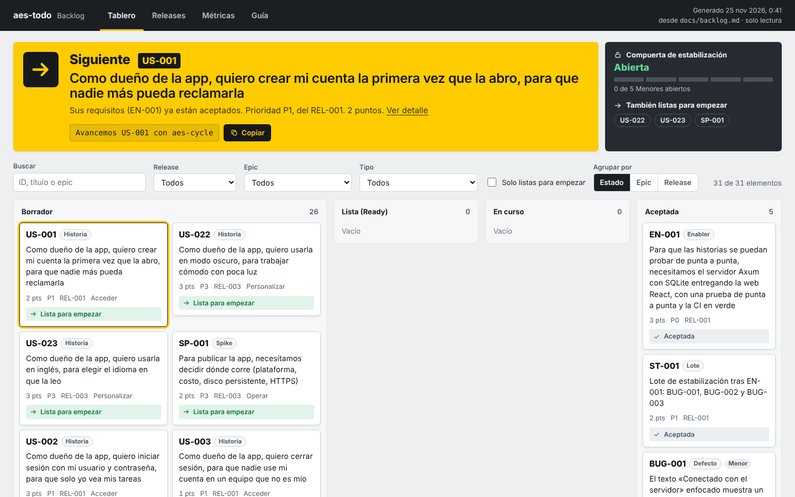
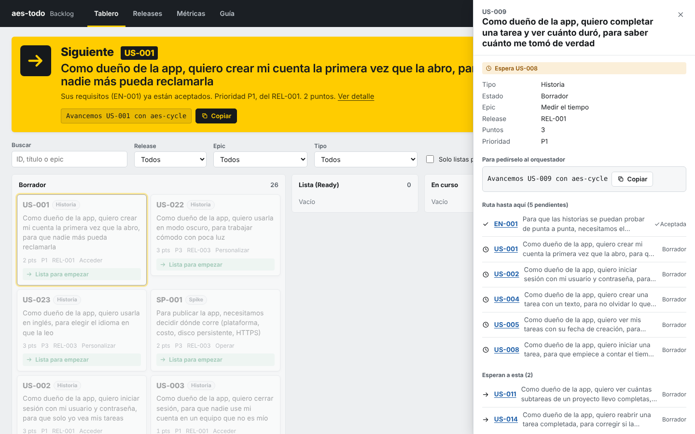
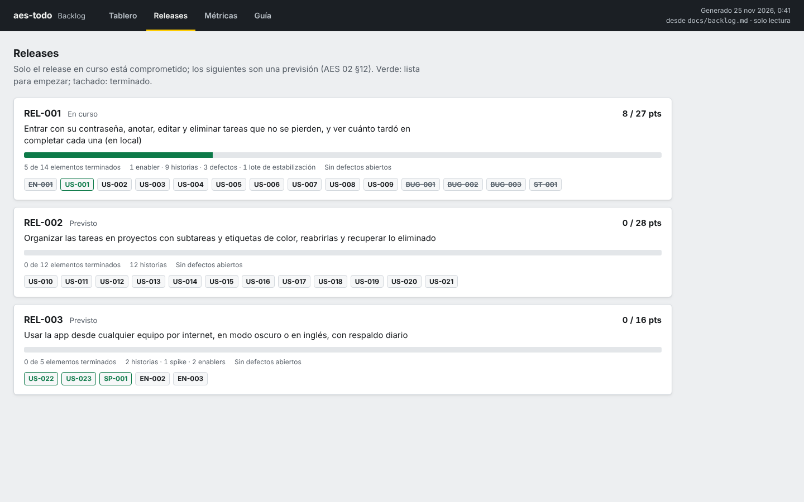
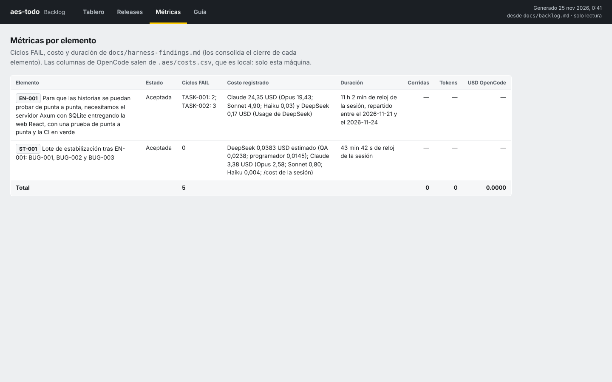
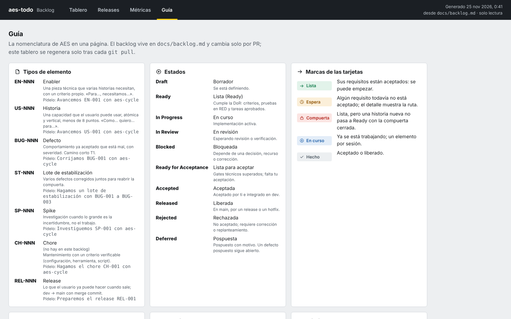
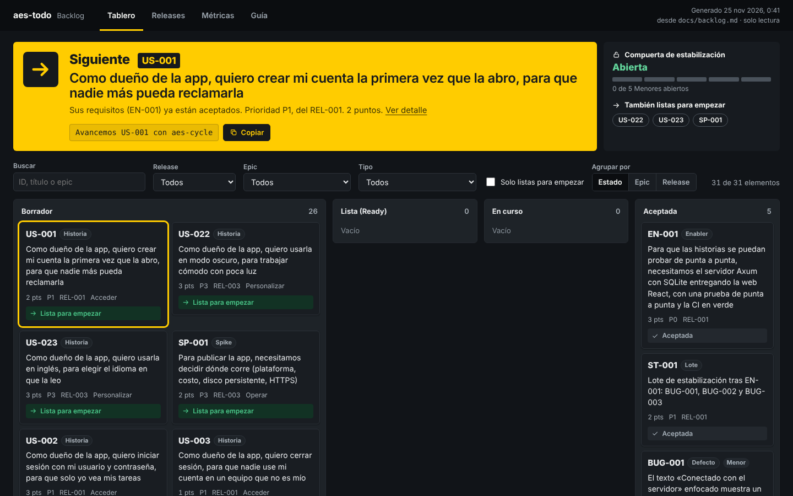

# Agentic Engineering Standard (AES)

**Version:** 2.1.0 · **Status:** in use

AES is an engineering process for building and maintaining software with AI coding agents **without having to read every line they write to trust the result**. It is harness-agnostic (Claude Code, OpenCode, others), model-agnostic and stack-agnostic, and it ships with a working reference implementation: agent contracts, hooks, CI gates, scripts and a backlog board.

> **Language.** AES is written in English. A project chooses the language its agents write in (`AES_LANG`: `en` or `es`), and the scripts read backlogs, task files and reports in either. The Spanish edition of AES stays available at the `v1.6.0` tag.

## The problem

Coding agents are fast, but left alone they:

- wander off scope, write more code than asked, or build what nobody requested;
- edit, disable or delete tests to get a green run;
- turn a small bug into a cascade of documents when the process is heavy, or skip the process when it is light;
- carry defects from one story to the next until fixing one breaks another;
- make it hard to know what anything costs, or which model is worth using where.

## The idea in one sentence

**You approve the contract (acceptance criteria and acceptance tests); an independent agent writes those tests without seeing the code; the programmer agent cannot touch them; CI runs them from a copy nobody can alter; and an independent verifier re-runs everything and exercises the real application before anything is merged.**

## Results so far

AES is being validated on [aes-todo](https://github.com/KeylorBrenes/aes-todo), a Rust (Axum + SQLx + SQLite) and React + TypeScript app built end to end by agents: **Claude Opus** orchestrates and designs, **Claude Sonnet** verifies, and **DeepSeek V4.1 Flash** (via OpenCode) writes tests and code.

| | EN-001 — walking skeleton | ST-001 — stabilization batch |
|---|---|---|
| FAIL cycles | 5 | **0** |
| Claude cost | USD 24.35 | **USD 3.38** |
| DeepSeek cost | USD 0.17 | USD 0.04 |
| Wall-clock | 11 h over 4 days | 44 min, one session |
| Hook / permission blocks | 9 | 0 |

The first item exposed real problems. The diagnosis showed they were **not the cheap model**: the verifier passed every run, and the FAIL cycles came from gaps in the design notes (focus management, live regions, API edge cases), a rule that turned minor findings into rework, and harness bugs on Windows. Each pattern got a control (AES 1.4.1 → 1.5.2), and the next item ran clean. ST-001 is smaller than EN-001, so the fair comparison is the next user stories; the full analysis is in the **[case study](docs/case-study.md)**.

## How it works

```
0. Stabilization gate: open defects?                        [CI]
   └─ an open Critical, High or Medium defect → stabilization batch first
   Classify the track (T0–T3)                     [orchestrator → you confirm]
1. Atomic, vertical story ("As a… I want… so that…") in customer language:
   criteria + out of scope + plan + decisions (D-NN)  [orchestrator → you approve]
2. Interface contract, if there is a new boundary       [architect]
3. QA agent: visible + holdout tests, one per criterion
   → RED confirmed by tooling → assumptions resolved → protected branch
                                              [you approve tests and assumptions]
4. Tasks per criterion: change surface, criteria they close, exact commands,
   a design note per task, and a model level per task (standard / high)
5. Programmer agent (fresh session per task):
   baseline → RED/GREEN/REFACTOR → struct:/feat: commits → report
6. CI: the task's criteria + regression from a trusted ref, holdout, SAST, guard
7. Verifier agent (clean session, read-only), BEFORE merging:
   re-run → hands-on testing of the real app → PASS / FAIL / BLOCKED
   └─ 3 FAILs on the same task → circuit breaker
   └─ findings classified: code defect vs. spec gap, with severity
8. You: report → approve the verification → merge
9. Close: demo → Accepted / Rejected → regression on dev
10. Retrospective: failure log → one new control per pattern
11. Release when you decide: dev → main (merge commit) → back-merge to dev
```

| Track | For | Minimum process |
|---|---|---|
| T0 | Typos, non-functional config | Task + CI |
| T1 | Bug, chore, stabilization batch | Short path: protected reproduction check (RED) + tasks |
| T2 | New functionality | Full cycle |
| T3 | Auth, data, payments, migrations, architecture | Full cycle + ADR + holdout + human review of risky code |

**Three layers of control** keep agents honest regardless of the model:

- **L1, permissions:** what each role may run or read (no network, no publishing credentials for agents).
- **L2, hooks:** what each role may write. The programmer cannot touch acceptance tests, specs or CI; violations are blocked, not just discouraged.
- **L3, CI:** the guard checks the change surface, the production budget, RED-before-GREEN, holdout tests, approvals by label (`aes:deps-approved`, `aes:budget-approved`) and the stabilization gate. Agents publish through a GitHub App **without** workflow permissions, so no agent can change the CI that judges it.

**Multi-model by design.** Each role has a binding (`claude`, `claude:<model>` or `opencode:<provider>/<model>`), and each task can request a higher model level with a stated reason, for example "read this whole legacy database schema". Every OpenCode run is costed per task, peak-hour pricing included.

## The backlog board

`docs/backlog.md` is the single source of truth. `.claude/scripts/aes-board.mjs` turns it into `.aes/board.html`: one self-contained file, no network or dependencies, regenerated after every `git pull` by a local git hook. It is read-only: the backlog changes through pull requests. Screenshots are from [aes-todo](https://github.com/KeylorBrenes/aes-todo) with its real data; that project is in Spanish (`AES_LANG=es`), so its board is too. With `AES_LANG=en` the same board is in English.

**What to work on now.** The yellow "Next" sign shows the item to work on and why, plus the exact sentence to give the orchestrator, with a copy button. The side panel shows the stabilization gate and the other items ready to start. Every card stays visible and says whether it is ready, waiting on something specific, held by the gate, in progress or done.



**Item detail.** The remaining prerequisites in order, what depends on this item, backlog notes, metrics and links to the spec and the retrospective. On the board, its prerequisites and dependents light up. Deep link: `board.html#d=US-009`.



**Releases, metrics and a guide.** Progress per release by points and items, FAIL cycles and cost per item, and the AES naming conventions on one page. Light and dark mode follow the system, and the board is fully keyboard-operable.









## Start a new project

Create the project folder, download the script there and run it (macOS, Linux, or Windows with Git Bash):

```bash
mkdir my-app && cd my-app
curl -fsSL https://raw.githubusercontent.com/KeylorBrenes/AES---Agent-Method/main/scripts/aes-new.sh -o aes-new.sh
bash aes-new.sh
```

It asks a few questions, each with a default:

1. **Repository:** confirms the folder, names the repository after it, makes it public by default, and asks for the project language (English or Spanish).
2. **Agent identity:** the agents publish through their GitHub App, or in personal mode with your own `gh` session.
3. **Where QA, programmer and mechanic run:** Claude Code or OpenCode, and which model.
4. **Third-party skills:** whether to add them ([archify](https://github.com/tt-a1i/archify), [impeccable](https://github.com/pbakaus/impeccable)).

It then creates the repository, installs AES, sets up `main` and `dev` with branch rules, and finally asks **"Start now?"**, which opens Claude Code with the orchestrator ready to interview you about the idea (inception). From there it is one session per backlog item: *"Advance US-001 with aes-cycle"*.

Requirements: git, gh, jq, node, Claude Code and, if you choose it, OpenCode. `bash .claude/scripts/aes-doctor.sh` checks everything a role needs before delegating, including a minimal compile of your stack.

## Repository layout

| Path | Content |
|---|---|
| `standard/` | The normative rules, chapters 00–10 (governance, inception and architecture, backlog, stories, tasks, testing, agent governance, change and release, DoR/DoD, process improvement, design). |
| `AES-CORE.md` | All of `standard/` in one generated document. |
| `templates/` | Brief, architecture, ADR, backlog, story, technical plan, task, design note, defect, stabilization batch, acceptance test plan, verification report, project profile, failure log. |
| `skills/` | AES core skills in Agent Skills format: inception, orchestrator cycle, design note, root-cause debugging, security review. |
| `agent-contracts/` | Responsibilities, permissions and limits of each role: orchestrator, architect, QA, programmer, mechanic, verifier. |
| `profiles/reference/claude-code-subagents/` | The reference implementation: Claude Code subagents, OpenCode delegation, hooks, CI workflow, guard, stabilization gate, scripts and the board. |
| `scripts/` | `aes-new.sh` (new project), `setup-repo.sh`, `install-aes.sh` (install, `--upgrade`, `--check`). |
| `docs/` | RFCs and the [case study](docs/case-study.md). |

## Normative words

MUST / MUST NOT, SHOULD / SHOULD NOT and MAY carry their RFC 2119 meaning. They describe the strength of a rule, not a particular tool.

## Versioning

Semantic versioning: MAJOR for incompatible changes to fundamental rules, MINOR for new compatible rules or capabilities, PATCH for fixes and clarifications. Every project declares the AES version it adopts, and upgrades are reviewed, not applied silently (`install-aes.sh --upgrade` proposes `.aes-new` files for anything the project adapted). See [CHANGELOG.md](CHANGELOG.md).

## Scope

AES covers the engineering cycle: inception, backlog planning with proportional tracks and a stabilization gate, relative estimation, small task design, ATDD/TDD with protected and holdout tests, layered agent governance, independent verification, human acceptance and continuous improvement of the harness. It does not prescribe languages, frameworks, model providers, tracking tools or a universal software architecture.

## Main sources

- Simon Willison — [Agentic Engineering Patterns](https://simonwillison.net/guides/agentic-engineering-patterns/)
- Kent Beck — [Augmented Coding: Beyond the Vibes](https://kentbeck.com/summaries/augmented-coding-beyond-the-vibes/)
- Alonso, Yovine and Braberman — TDAD (arXiv:2603.17973), summarized in [TDAD and the testing revolution](https://codex.danielvaughan.com/premium-pdfs/04-tdad-and-the-testing-revolution.pdf)
- Birgitta Böckeler — [Understanding Spec-Driven-Development: Kiro, spec-kit, and Tessl](https://www.martinfowler.com/articles/exploring-gen-ai/sdd-3-tools.html)
- Anthropic — [Equipping agents for the real world with Agent Skills](https://www.anthropic.com/engineering/equipping-agents-for-the-real-world-with-agent-skills)

The rationale for each version is in `docs/rfc/` (in Spanish for now): [RFC-001](docs/rfc/RFC-001-aes-1.1.0.md) for 1.1.0, [RFC-002](docs/rfc/RFC-002-aes-1.2.0.md) for 1.2.0 with the evidence from the first sandbox, [aes-sandbox-gastos](https://github.com/KeylorBrenes/aes-sandbox-gastos), and later RFCs for 1.3.0 and 1.4.0.

## License

AES is dual-licensed: the **code** (scripts, hooks, CI workflows, the board) under the [MIT License](LICENSE-MIT.txt), and the **standard, templates, agent contracts, skills and documentation** under [CC BY 4.0](LICENSE-CC-BY-4.0.txt). Details in [LICENSE](LICENSE).
